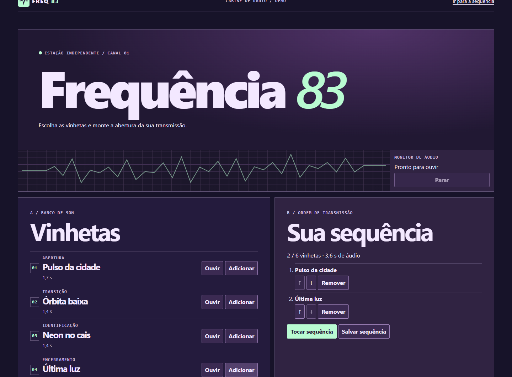

# Frequência 83

Cabine fictícia de rádio. Ouça quatro vinhetas originais, ordene uma sequência de até seis peças e compartilhe o link.



A ideia de organizar uma fila reproduzível veio das [playlists do Spotify](https://support.spotify.com/br/article/create-playlists/). O projeto tem identidade própria e sintetiza as vinhetas com Web Audio, a partir de partituras fictícias. Lit renderiza os controles e o servidor valida e guarda a ordem em SQLite/D1. Os links expiram em sete dias.

## Desenvolvimento

Node.js 24 e npm.

```sh
npm ci
npm run build
npm start
```

Abra http://127.0.0.1:4173. O SQLite local fica em `.local/frequencia.sqlite`.

```sh
npm test
npx playwright install chromium
npm run test:browser
```

[Contrato de integração](docs/solution-contract.md)
